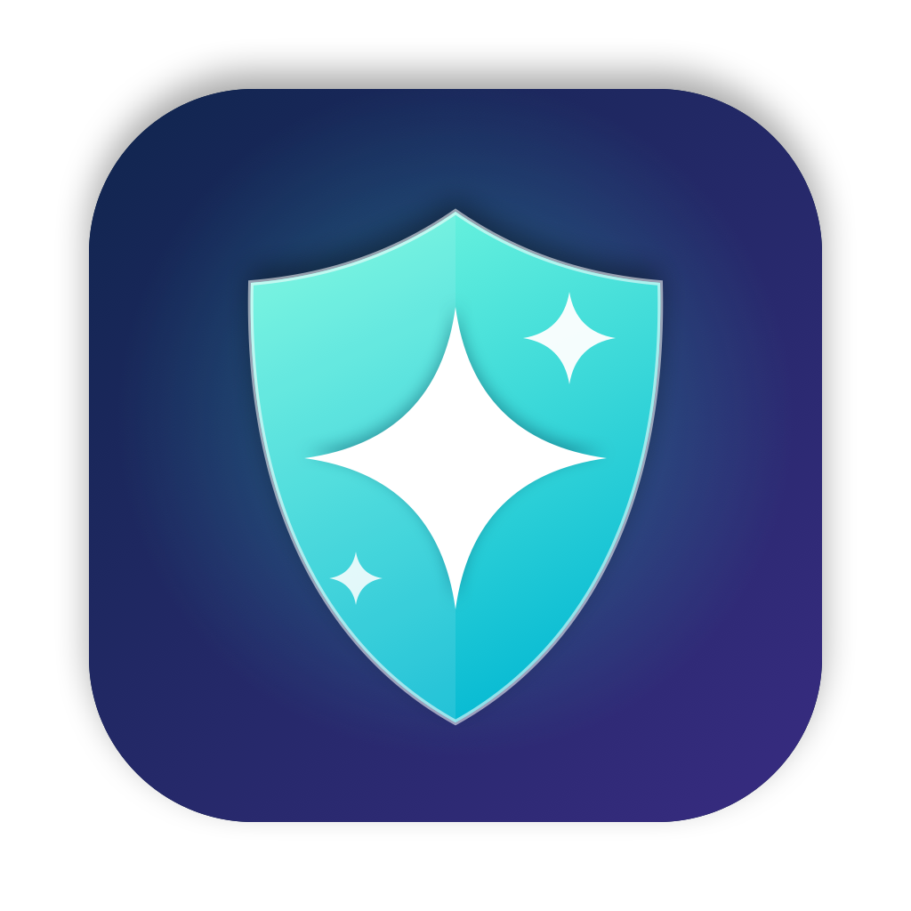
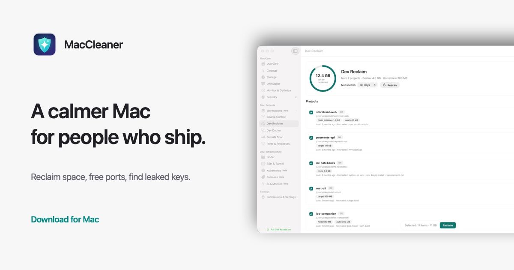

<p align="center"></p>

# Calmdeck

A calm, local-first Mac utility for developers. Calmdeck gives your disk back from Xcode, Docker and node_modules, and tells you who's sitting on port 3000.

**[Website](https://andyphan0508.github.io/calmdeck/)** · **[Download](https://github.com/andyphan0508/calmdeck/releases/latest/download/Calmdeck.dmg)** · **[Changelog](https://andyphan0508.github.io/calmdeck/changelog.html)**



## What it does

- **Dev Reclaim:** Xcode DerivedData, old simulators, Docker data, package caches and node_modules in projects you haven't touched in months. You see exactly what will be removed before anything goes.
- **Ports:** which process listens on each port and which project started it.
- **Secrets:** API keys and private keys on disk, flagged when they're committed to git. Values stay masked.
- **Servers and Kubernetes:** manage Linux servers over SSH and clusters from one window.

Everything runs on your Mac. No analytics, no account. Every deletion shows a summary and asks for Touch ID.

## Install

Requires macOS 26 or later on Apple silicon.

```bash
curl -fsSL https://andyphan0508.github.io/calmdeck/install.sh | bash
```

The script downloads the latest release from this repo and checks the code signature before copying the app to /Applications. [Read it first](https://andyphan0508.github.io/calmdeck/install.sh). If you download the DMG in a browser, macOS may ask you to allow it under System Settings → Privacy & Security.

## Guides

- [Safely clear Xcode DerivedData, Archives and simulators](https://andyphan0508.github.io/calmdeck/guides/clear-xcode-deriveddata.html)
- [What is using port 3000 on my Mac?](https://andyphan0508.github.io/calmdeck/guides/port-in-use-mac.html)
- [Free up disk space on a developer Mac](https://andyphan0508.github.io/calmdeck/guides/free-disk-space-developer-mac.html)

## Pricing

Free to use. Pro is a one-time 29 US$ for two Macs with a year of updates. During the Early Preview, Pro is free until 1 February 2027.

## Feedback

Open an [issue](https://github.com/andyphan0508/calmdeck/issues) for bugs and ideas. This repo hosts the website and releases; the app source is not public.
